<div align="center">

# ⚡ ADHD Mode

### Give Claude Code a neurodivergent brainstorm team.

**Zap** has 400 tabs open. **Doc** says yes to everything and then tells you how to build it. **Vera** has perfect taste and says no to 80% of it. When they can't agree, an **Idea Court** with a blind jury decides.

[](https://code.claude.com/docs/en/plugins)
[](LICENSE)


[Install](#install) · [Commands](#commands) · [The team](#the-team) · [Why it works](#why-it-works) · [🇮🇹 Italiano](README.it.md)

</div>

<p align="center"></p>

---

Ask an LLM for ideas and you get the **most likely** idea: the average of everything it has read. That's great for code and terrible for creativity.

ADHD Mode splits thinking the way creative studios do. One agent generates wildly and isn't allowed to build anything. One makes it technically real. One cuts it down with taste. Each step runs as a separate Claude Code subagent with its own context, so the wild one never gets "sensible-ified" by the critic halfway through a thought.

> **Real run →** [`/adhd-mode:adhd A to-do app for people with ADHD that they'd actually keep using --squirrel`](examples/adhd-todo-app.md)
> 25 ideas · two random Wikipedia squirrels (a metalcore band and a UK council election) · winner: **"Rushmoor Thirds"**, a to-do list where every 3 days a third of your tasks stand for re-election · blind jury verdict 3–2.

Use it for product ideas, UI and 3D design concepts, naming, architecture alternatives, and **getting unstuck on bugs**.

## Install

```bash
/plugin marketplace add MarcoZorn/adhd-mode
/plugin install adhd-mode@adhd-mode
```

Or from your shell: `claude plugin marketplace add MarcoZorn/adhd-mode && claude plugin install adhd-mode@adhd-mode`

## Commands

| Command | What happens |
|---|---|
| `/adhd-mode:adhd <problem>` | The full pipeline: Zap ⚡ → Doc 🧪 → Vera 🎯. Ends with one concrete winner and a first step for tomorrow. |
| `/adhd-mode:adhd bug: <symptom>` | Bug mode. 10+ cause hypotheses (the absurd ones too), ranked by **cheapest to test first**, each with a check that takes 5 minutes. |
| `/adhd-mode:adhd <problem> --squirrel` | Injects real randomness from outside the model (random Wikipedia articles) as forced analogies. |
| `/adhd-mode:adhd <problem> --trial` | Settles the top two ideas in Idea Court. |
| `/adhd-mode:trial <A> vs <B>` | Idea Court ⚖️: two advocates, five isolated jurors, a tallied verdict and the best dissent. |
| `/adhd-mode:squirrel <problem>` | SQUIRREL! 🐿️ Random Wikipedia articles, three forced-analogy ideas per squirrel, one collision idea. |
| `/adhd-mode:evolve <problem>` | 🧬 A genetic algorithm for ideas: breed, judge with jurors, crossbreed, mutate, repeat for N generations. |

You don't have to remember any of them. Say "go full ADHD mode on this" and Claude picks the right skill.

## The team

### ⚡ Zap: the idea engine
Hyperactive, hyperfocused, endlessly curious. Starts every problem with a **Why-Drill** (why, five levels deep) because the real problem is usually three layers down. Then generates 15–20+ ideas with named creative engines: *Alien Domain, Inversion, Delete the Constraint, 10,000× Scale, Wrong Answer First, Childbrain, Sensory Swap, Time Shift, Hyperfocus Detail, Collision*. Obvious ideas are banned and get filed under "Obvious stuff (ignored)".
**Zap can't write code or files.** It only has read tools, so the limit comes from the tool list and not from a polite request in the prompt.

### 🧪 Doc: the mad engineer
Has read every RFC and obscure repo. Answers every idea with "yes, and here's how", but **labels its madness**: every technical claim is tagged `[EXISTS]`, `[PLAUSIBLE]` or `[INVENTED]`. Doc's hallucinations become a feature you can see. It also runs a **prior-art web search** on the top ideas, so "nobody has done this" gets checked.

### 🎯 Vera: the designer with taste
Gives every idea a verdict (`KEEP` / `MERGE` / `KILL`) and usually kills about 80%. Picks one winner and protects its weird part from being sanded down. She turns it into what you see and feel, the smallest slice that still delivers the magic, and a first step for tomorrow. She adds a **📮 Postcard from 2031**, a pre-mortem on why the idea failed five years from now, plus a validation test that takes less than a day.

### ⚖️ Idea Court: advocates + a blind jury
Two advocates each defend one idea and prosecute the other. Five jurors judge **in isolation** (separate subagents that can't see each other), each from a different lens: end user, on-call engineer at 3am, skeptical investor, curious 12-year-old, historian from 2036. The briefs are **anonymized**, and their **order is randomized per juror** to cancel position bias, which is a known LLM-as-judge failure. Verdict comes with the tally and the strongest dissent.

### 🐿️ The Tangent Graveyard
Zap's side-quests and Vera's killed ideas are appended to `.adhd/tangents.md` in your project. Today's tangent might be next month's project.

## Why it works

- **Separation of divergence and convergence.** Generating and judging at the same time kills ideas early. Here they run in different contexts.
- **External entropy.** `--squirrel` pulls randomness from Wikipedia, outside the model's probability distribution, which breaks mode collapse in a way "be creative!" can't.
- **Labeled hallucination.** Doc is allowed to invent, but has to say when it's inventing.
- **Debiased judging.** Isolated jurors, anonymized exhibits, counterbalanced order, an odd jury, diverse lenses.
- **Tool-level constraints.** The idea agent can't edit anything. The judges can only read.

## Tests

The plugin ships with an eval suite for `claude plugin eval`. It runs each case with and without the plugin, so you can measure the difference yourself:

```bash
claude plugin eval . --trust-plugin
```

## FAQ

**Is this making fun of ADHD or autism?** No, the opposite. It's built around the parts of neurodivergent thinking that are a superpower: pattern-spotting, hyperfocus, asking "why?" one more time than anyone else, and connecting things nobody else connects. The team exists because no single brain should do every job.

**Does it cost a lot of tokens?** A full `/adhd` run is 3 subagents, `/trial` is 7, and `/evolve` is the expensive one. Use `/squirrel` for a quick hit.

**Can I change the personalities?** Yes. They're plain Markdown in [`agents/`](agents/). Fork it and make your own team.

## Contributing

New creative engines for Zap, new juror lenses, new skills: PRs welcome. Keep agents as plain prompts with no dependencies.

## License

MIT © Marco Zorn

<!-- keywords: claude code plugin, claude code agents, claude code subagents, ai brainstorming, ai brainstorming agents, multi-agent brainstorming, creative ai, ai ideation tool, llm as a judge, ai debate, adhd ai, neurodivergent, design ideas generator, bug hunting ai, rubber duck debugging, anthropic claude -->
